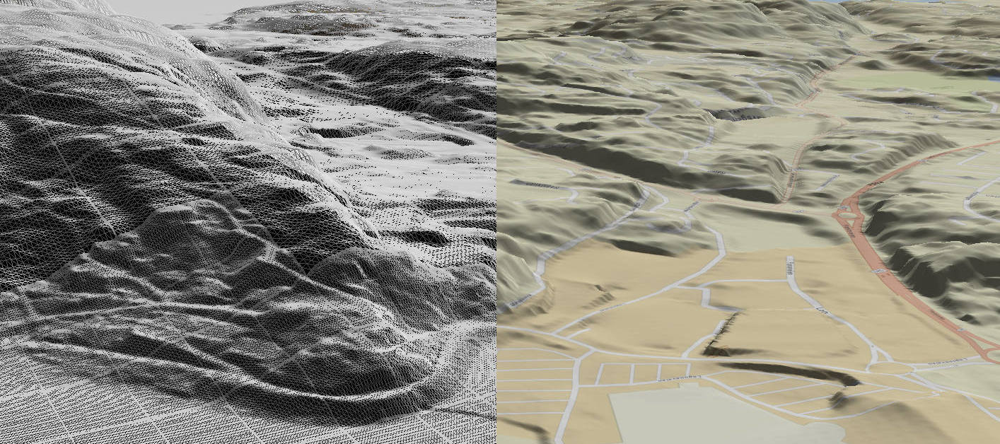

<p align="center" style="background-color: #202020;">
  
</p>
    
CTOD is a service designed to fetch Cesium terrain tiles (quantized mesh) dynamically generated from a Cloud Optimized GeoTIFF (COG). The core concept behind this service is to eliminate the need for creating an extensive cache, thereby saving time and storage space. Traditional caching methods often involve generating and storing numerous files, many of which may never be requested, resulting in unnecessary resource consumption. CTOD addresses this issue by generating terrain tiles on the fly, optimizing efficiency and reducing the burden on file storage.

> Don't care about on-demand? You can use CTOD to generate a cache for you aswell.

## TL;DR

```sh
docker run -p 5000:5000 \
-v ./ctod_cache:/cache \
-e CTOD_PORT=5000 \
-e CTOD_LOGGING_LEVEL=info \
-e CTOD_TILE_CACHE_PATH=/cache \
ghcr.io/sogelink-research/ctod:latest
```

[Open the local running demo viewer](http://localhost:5000)

## Features

- Generate and fetch a layer.json derived from COG, accommodating all projections.
- Retrieve .terrain tiles by tile index, currently supporting grid and martini based mesh.
- Support for extension octvertexnormals
- Support for .vrt and (custom) mosaic
- Averaging of heights and normals on shared edge vertices among terrain tiles.
- Empty tiles with geodetic surface normals.
- Caching for seamlessly stitching neighboring tiles and preventing redundant requests.
- CogProcessor and TerrainGenerator for diverse terrain serving implementations (grid, martini, custom).
- Basic tile caching implementation
- Basic Cesium viewer included for debugging and result visualization.
- Scripts to partly seed cache and generate mosaic dataset.
- Works with Cesium for Unity

## Wiki

- [Meshing methods](https://github.com/sogelink-research/ctod/wiki/Meshing-methods)
- [Tile stitching](https://github.com/sogelink-research/ctod/wiki/Tile-stitching)
- [COG Optimization](https://github.com/sogelink-research/ctod/wiki/COG-Optimization)
- [Seeding the cache](https://github.com/sogelink-research/ctod/wiki/Seeding-the-cache)
- [VRT and Mosaic](https://github.com/sogelink-research/ctod/wiki/VRT-and-Mosaic) ToDo

## Example result in Cesium


***Wireframe and mesh in Cesium using grid based meshing***

## Future work (V1.1.0)

- Option to disable preview/homepage
- Mosaic dataset priority
- Support multiple workers
- Disable GIL with new Python version?
- Profiling to see where we can gain some performance
- Extension support: Metadata, Watermask

## Settings

The following options can be set by supplying args to app.py or setting the environment variables.

|argument|environment variable|description|default|
|-|-|-|-|
|--tile-cache-path|CTOD_TILE_CACHE_PATH|Cache dir, not set = cache disabled|None|
|--dataset-config-path|CTOD_DATASET_CONFIG_PATH|Path to the dataset JSON config file|./config/datasets.json|
|--logging-level|CTOD_LOGGING_LEVEL|debug, info, warning, error, critical|info|
|--port|CTOD_PORT|Port to run the service on|5000|
|--unsafe|CTOD_UNSAFE|Load unsafe tiles (not enough COG overviews or too many datasets in 1 tile), can result in huge and or stuck requests||
|--no-dynamic|CTOD_NO_DYNAMIC|Disable the dynamic endpoint, only datasets configured in the config can be used||
|--cors-allow-origins|CTOD_CORS_ALLOW_ORIGINS|Set allowed origins for CORS|http://localhost:5000|

## Run CTOD

Run CTOD using docker or from source, see `Settings` for configuration options.

### Using Docker

Example running CTOD using the docker image with a mounted volume and caching enabled.

```sh
docker run -p 5000:5000 \
-v ./ctod_cache:/cache \
-e CTOD_TILE_CACHE_PATH=/cache \
ghcr.io/sogelink-research/ctod:latest
```

### From source

Install and run CTOD in a virtual environment using poetry.

```sh
poetry env use python3.10
poetry install
poetry shell
poetry run start
```

To enable caching, supply --tile-cache-path `path` with the start command.

```sh
poetry run start --tile-cache-path ./ctod_cache
```

## --no-dynamic

The idea is that an user can use every COG that the CTOD service can access with the parameters the user wants, this can expose a problem when CTOD is available on the internet. A random user can use your CTOD instance to generate his own .terrain tiles or even mess up a cache by supplying weird grid sized. 

To prevent a user to use any cog with any parameter the endpoints are split up into `/tiles/dynamic/..` and `/tiles/{dataset}/..`. The dynamic endpoint accepts parameters and is flexible to use where the `/tiles/{dataset}` endpoint can only be [configured](#dataset-configuration) with a config file and ignores parameters.

The dynamic endpoint can be disabled by supplying the option `--no-dynamic` to CTOD or set the environment variable `CTOD_NO_DYNAMIC` to `TRUE`. This way only configured datasets can be used with set parameters.

## Endpoints

Endpoint documentation for your running CTOD service can also be found under `/doc`.

### Endpoint: `/`

Shows the available datasets and a link to open a preview viewer using the dataset.

#### Request

- **Method:** GET
- **URL:** `http://localhost:5000`

### Endpoint: `/docs`

The CTOD OpenAPI documentation with Swagger UI

#### Request

- **Method:** GET
- **URL:** `http://localhost:5000/docs`

### Endpoint: `/status`

Can be used to check if CTOD is online

#### Request

- **Method:** GET
- **URL:** `http://localhost:5000/status`

### Endpoint: `/tiles/dynamic/layer.json`

Dynamically generates a layer.json based on the COG. The supplied parameters will be picked up by Cesium when using this url for the CesiumTerrainProvider and passed down to the .terrain requests.

#### Request

- **Method:** GET
- **URL:** `http://localhost:5000/tiles/dynamic/layer.json`

#### Parameters <a name="parameters-sub"></a>

See [Parameters](#parameters)

#### Example

```sh
http://localhost:5000/tiles/dynamic/layer.json?maxZoom=18&cog=./ctod/files/test_cog.tif
```

### Endpoint: `/tiles/{dataset}/layer.json`

Dynamically generates a layer.json for a configured dataset, replace {dataset} with a dataset configured in `datasets.json`, all supplied url parameters will be ignored.

#### Request

- **Method:** GET
- **URL:** `http://localhost:5000/tiles/{dataset}/layer.json`

#### Example

```sh
http://localhost:5000/tiles/demo/layer.json
```

### Endpoint: `/tiles/dynamic/{z}/{x}/{y}.terrain`

Get a quantized mesh for tile index z, x, y. Set the minZoom value to retrieve empty tiles for zoom levels lower than minZoom. maxZoom is handled in the generated layer.json.

#### Request

- **Method:** GET
- **URL:** `http://localhost:5000/tiles/dynamic/{z}/{x}/{y}.terrain`

#### Parameters <a name="parameters-sub"></a>

See [Parameters](#parameters)

#### Example

```sh
http://localhost:5000/tiles/dynamic/17/134972/21614.terrain?minZoom=1&cog=./ctod/files/test_cog.tif
```

### Endpoint: `/tiles/{dataset}/{z}/{x}/{y}.terrain`

Get a quantized mesh for tile index z, x, y. Replace {dataset} with a dataset configured in `datasets.json`, all supplied url parameters will be ignored.

#### Request

- **Method:** GET
- **URL:** `http://localhost:5000/tiles/{dataset}/{z}/{x}/{y}.terrain`

#### Example

```sh
http://localhost:5000/tiles/demo/17/134972/21614.terrain
```

### Parameters <a name="parameters"></a>

- **cog**: Path or URL to COG file.
- **minZoom** : The min zoomlevel for the terrain. Default (0)
- **maxZoom** : The max zoomlevel for the terrain. Default (18)
- **noData** : The value to use for NoData in COG. Default (0)
- **resamplingMethod** : Resampling method for COG: 'nearest', 'bilinear', 'cubic', 'cubic_spline', 'lanczos', 'average', 'mode', 'gauss', 'rms'. Default 'none'
- **skipCache** : Set to true to prevent loading tiles from the cache. Default (False)
- **meshingMethod**: The Meshing method to use: 'grid', 'martini', 'delatin'

#### Parameters for meshing method: grid

- **defaultGridSize**: The default grid size (amount of rows/cols) to use if there is no specific zoomGridSizes defined for a requested tile, Default (20)
- **zoomGridSizes**: Per level defined grid size, when requested zoom for tile not specified use defaultGridSize. Default when defaultGridSize and zoomGridSizes not set (`{"15": 25, "16": 25, "17": 30, "18": 35, "19": 35, "20": 35, "21": 35, "22": 35}`)

#### Parameters for meshing method: martini

- **defaultMaxError**: The default max triangulation error in meters to use, Default (4)
- **zoomMaxErrors**: Per level defined max error, when requested zoom for tile is not specified use defaultMaxError. Default when defaultMaxError and zoomMaxError not set (`{"15": 8, "16": 5, "17": 3, "18": 2, "19": 1, "20": 0.5, "21": 0.3, "22": 0.1}`)


## Dataset configuration

It may be usefull to preconfigure a dataset in a config file, this makes the url cleaner and a user cannot override settings which can result in different configured tiles in the cache. When the option `--no-dynamic` is supplied to CTOD only datasets from the config can be used and the dynamic datasets are disabled.

By default CTOD tries to look for the dataset config at `./config/datasets.json`, this can be overwritten with `--dataset-config-path` or environment variable `CTOD_DATASET_CONFIG_PATH`. When the config could not be found or has an error CTOD continues and logs an error.

The exact same parameters as described in the topic [parameters](#parameters) can be used in the `.json` file for a dataset.

### Example config

```json
{
    "datasets": [
        {
            "name": "demo",
            "options": {
                "cog": "./ctod/files/test_cog.tif",
                "minZoom": 13,
                "maxZoom": 17,
                "noData": 0,
                "meshingMethod": "grid",
                "skipCache": false,
                "zoomGridSizes": {"13": 5, "14": 10, "15": 15, "16": 20, "17": 25, "18": 30, "19": 35}
            }
        },
        ...
    ]
}
```

## More info

### How to use in Cesium

To use the CTOD terrain tiles in Cesium, create and set a `CesiumTerrainProvider` initialized with the url to the CTOD service. The layer.json file will be requested on the /tiles endpoint followed by .terrain requests while passing the options to the endpoints.

```js
viewer.terrainProvider = new Cesium.CesiumTerrainProvider({
    url: `https://ctod-service/tiles/dynamic/?minZoom=1&maxZoom=18&cog=MyCogPath`,
    requestVertexNormals: true
});
```

### Caching

The CTOD service has a very basic tile caching option, tiles can be retrieved and saved by supplying a cache path when starting app.py or setting the environment variable `CTOD_TILE_CACHE_PATH`. Based on this path and the requested cog, meshing method and resampling method a tile can be saved and retrieved from disk. the cog path/url will be encoded into a hex string. When a service is started with caching the cache can be circumvented by adding `ignoreCache=True` to the terrain request.

### Nodata

Nodata values in the COG are automatically set to 0 else it is likely that the meshing will go wrong, for now nodata should be handled in the source data (COG) or pass `noData={value}` to the .terrain request to overwrite the default value `0`

### Used libraries

- [rio-tiler](https://github.com/cogeotiff/rio-tiler): Rasterio plugin to read raster datasets. (BSD-3-Clause)
- [pydelatin](https://github.com/kylebarron/pydelatin): Terrain mesh generation. (MIT)
- [pymartini](https://github.com/kylebarron/pymartini): Terrain mesh generation. (MIT/ISC)
- [quantized-mesh-encoder](https://github.com/kylebarron/quantized-mesh-encoder): A fast Python Quantized Mesh encoder. (MIT)
- [morecantile](https://github.com/developmentseed/morecantile): Construct and use OGC TileMatrixSets. (MIT)

## Stargazing / Mars terrain

The named `mars` dataset uses `options.body: "mars"`. Its separate terrain path
reads the native spherical equirectangular DEM without attempting Earth/Mars CRS
conversion. Earth datasets continue to use the existing pipeline.

Supported Mars input: one north-up band, global coverage, equatorial spherical
equirectangular projection with radius **3396190 m**, zero offsets/origin, and
longitude coverage 0–360 or -180–180. Other projections fail validation instead
of producing misplaced terrain. Source heights must be in metres with scale=1
and offset=0. The current COG does not declare its vertical datum or band unit;
its numeric DEM elevations are preserved. No areoid-to-ellipsoid correction has
been applied, so this is a relief visualization, not a validated absolute-radius
scientific product.

The Mars path supports `grid` and nearest sampling. Source overviews are selected
consistently per zoom. Shared tile boundaries sample the same positions, including
0/360 and ±180; polar vertices share one height. Normals use central differences
across tile boundaries. Grid subdivisions are clamped to 16–128 for curvature and
bounded tile size. Unlike the Earth path, zoom 0 includes source relief.

Mars uses up to four workers with reusable, worker-specific raster readers and a
128-tile memory cache per dataset. Cache entries distinguish the normals variant;
other options are fixed for that dataset instance. `skipCache: true` disables both
reads and writes to this Mars cache. The Earth disk/SQLite cache is not used for
Mars. Changing the source file requires a restart and is detected before serving
cached tiles. Failures return 503, timeouts 504, invalid coordinates 404.

Run CTOD on a port of your choice with `--port` / `CTOD_PORT`; Stargazing does
not require a particular port. Enter the terrain URL in Stargazing's connection
panel, or set `STARGAZING_CONFIG.terrainUrl` before its module script.

CORS accepts HTTP(S) localhost, 127.0.0.1 and [::1] origins on any port by default.
Other hosts require the **frontend origin**, not CTOD's own origin, in
`--cors-allow-origins` / `CTOD_CORS_ALLOW_ORIGINS`. Whitespace and trailing slashes
in the list are normalized. For production, disable the loopback policy with
`CTOD_CORS_ALLOW_ORIGIN_REGEX=""` and explicitly allow your frontend origins.
Restart the service after changing these settings. Startup logs show the policy.

Set the dataset's `cog` path in `config/datasets.json`; environment variables in
that path are expanded (for example `${MARS_DEM_PATH}`). For another dataset
configuration, use `--dataset-config-path`. Do not overwrite the raster's CRS
with EPSG:4326 to suppress errors. `layer.json` uses that projection identifier
only for Cesium's geographic tile addressing and separately declares the Mars
body and ellipsoid, which Stargazing validates.

Regression checks (synthetic DEM, no external downloads):

```sh
poetry run python -m unittest discover -s tests -v
```

The suite covers native sampling, longitude wrap, polar/seam continuity, encoded
Mars headers, cache variants, bounded asynchronous work, error propagation,
reader reuse, HTTP status codes, gzip, and CORS.

The encoder 0.4.x horizon-occlusion point is converted from metres to the
ellipsoid-scaled frame required by the quantized-mesh header. Mars tile version
2.0.1 and the Earth cache identity invalidate older encoded headers. Regression
tests check that high-zoom occlusion coordinates have unit-scale magnitude.
